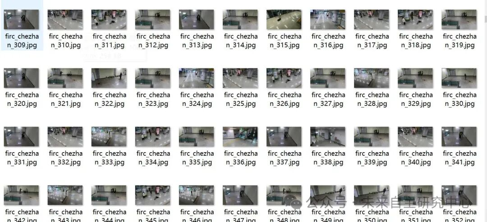
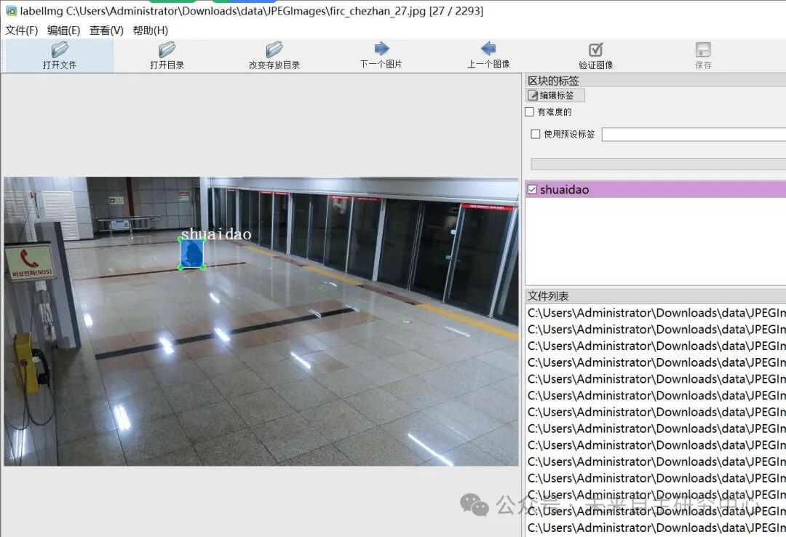

# VOC+YOLO format: 2293 images in 4 categories for station anomaly behavior detection dataset

Dataset format: Pascal VOC format + YOLO format (txt file without split path, only containing jpg images and corresponding VOC format xml files and yolo format txt files)

Number of images (number of jpg files): 2293

Number of annotations (number of xml files): 2293

Number of annotations (number of txt files): 2293

Labeling category count: 4

Annotation category names: ["gongji", "guyipohuai", "shuaidao", "zhengchang"] => [Attack, Intentional Damage, Fall, Normal]

Number of boxes labeled in each category:

Gongji Frame Count = 794

Guyipohuai frame count = 86

shuaidao frame count = 1210

Zhengchang Frame Count = 2770

Total frame count: 4860

Using labelImg:

Annotation rules: Draw a rectangle around the category.

Important Notice: No

Special : This dataset does not guarantee the accuracy or precision of the trained models or weight files. The dataset is provided with accurate and reasonable annotations only.

Image Preview:

Annotation example:

## Payment

Here is a pay link on Stripe ( https://buy.stripe.com/3cs8yP7sY87d0vu9AB ). Please contact me lonlonago@foxmail.com after funding $89, and I will send you a complete data files , thank you!

